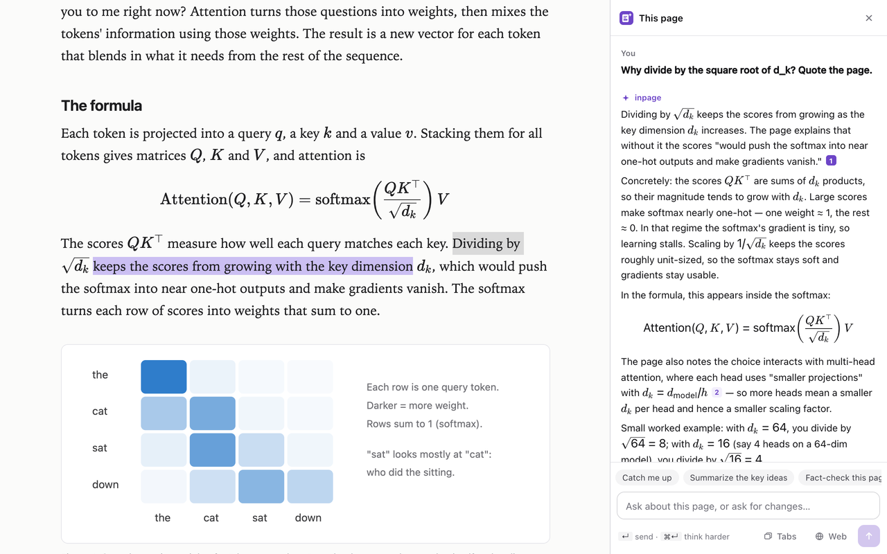
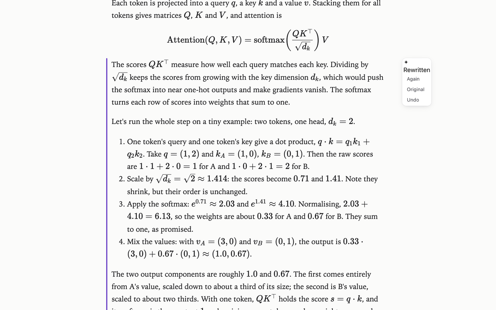
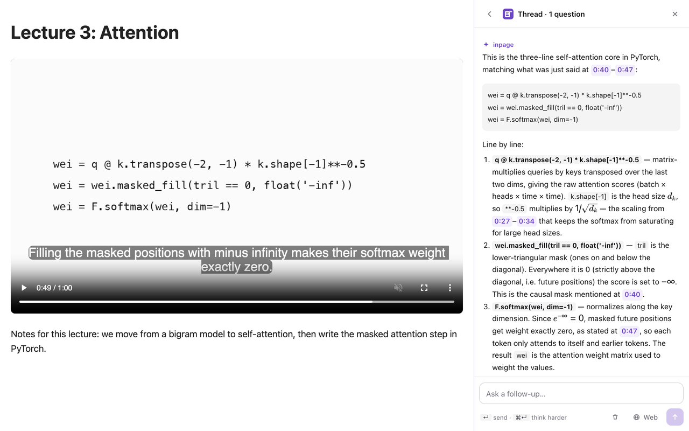

<p align="center"></p>
<h1 align="center">inpage</h1>
<p align="center">A learning copilot that lives in the page. Select anything to ask about it or rewrite it in place, styled like the site, with real maths.</p>

<p align="center"></p>

## What it does

inpage lives in the page you're reading, plus the browser's side panel for conversations: the page shrinks beside it, like the browser's own panels.

- **Ask about a selection.** Select text, click **Ask**. The answer streams into the side panel with Markdown, tables and KaTeX maths; follow up in the same thread. A pin in the margin brings it back.
- **Rewrite in place.** Click **Rewrite** (or Alt-click a paragraph) and say how: *step by step*, *add a numeric example*, *simpler*, *define the terms*. The new text streams into the page in the site's own style and maths renders properly. **Again**, **Original** and **Undo** sit beside every edit.
- **Ask about the whole page, or change it.** Open the panel (Alt+Shift+I): *summarise the key ideas*, or *add a check-your-understanding question after each section*. Page-wide changes stream into the page three at a time, with **Review** and **Undo all**.
- **Images.** Hover a figure and click **Ask about this**: the model sees the image, its caption and the text around it.
- **Lecture companion.** On a video, *Ask about this moment*: inpage reads the captions from the last few minutes and the frame on screen (the slide or code), answers with timestamps you can click, and pins the thread to that moment. Rewind the same part twice and it offers a recap.
- **Answers you can check.** Page answers quote the page with numbered chips; click one to see the exact sentence. Quotes are verified against the page, and every answer shows what was sent, the model and the exact cost.
- **Across your tabs.** Pick open tabs (or just say "my open tabs") and ask across them: comparisons where every point links to the quote in its own tab.
- **Catch me up.** A recap of what you've read so far, with nothing from further down the page.
- **Quiet memory.** Select a term you've asked about before, on any page, and your earlier explanation appears above the toolbar. Long pages you left part-way offer to take you back. Keep coming back to a paragraph and a small "Stuck? Explain this" appears.
- **Your own actions.** One-click prompts in the selection toolbar, composer and panel: *Explain like Karpathy*, *Turn into code*, *Critique this claim*, or anything you make. Create or change them by chatting in the panel ("make an action that turns a selection into flashcards and pin it"), or in Settings; export and import them as JSON.
- **Fact-check.** One chip checks the page's key claims (or a selection's) against the web: claims are tinted supported, disputed or unclear in place, with notes and sources in the panel. About $0.005 a claim.
- **All your notes in one place.** A library of every page you've asked about or changed, searchable, with Markdown export (Obsidian-ready maths) and JSON backup.
- **Web search** when you want it: one toggle; answers cite their sources.
- **Fast routing with Jev.** A fast judgment model decides in about 0.4 s whether a page request is a question or a change, so questions start answering about a second sooner. It also turns on web search or careful reasoning when a question needs them, and warns you when a page contains text that tries to instruct AI assistants. About $0.00003 a call; switch it off in Settings.
- **Everything is saved per page** and comes back when you return, including on single-page apps.
- Works with light and dark sites, strict security policies (GitHub), MathML (Wikipedia), MathJax/KaTeX blogs, arXiv HTML papers, and old quirks-mode pages.

<p align="center"> </p>

## Install

inpage is coming to the Chrome Web Store. Until then, install it from a release:

1. Download `inpage-<version>.zip` from the [latest release](https://github.com/harish-anumula/inpage/releases/latest) and unzip it.
2. Open `chrome://extensions` (or `edge://extensions`), turn on **Developer mode**, click **Load unpacked**, and choose the unzipped folder.
3. The settings page opens: paste an [OpenRouter API key](https://openrouter.ai/keys) and click **Save**.
4. Select text on any page.

**Cost.** inpage uses your own OpenRouter key. The default model, DeepSeek V4.1 Flash, costs about $0.0002–0.001 per question or rewrite; web search adds about $0.005.

## Keyboard

| | |
|---|---|
| Alt+Shift+A | Ask about the selection |
| Alt+Shift+R | Rewrite the selection |
| Alt+Shift+I | Open or close the panel |
| Alt-click | Rewrite a paragraph, or ask about an image |
| ↵ / ⌘↵ | Send / send with "think harder" |
| Esc | Close |

Change them at `chrome://extensions/shortcuts`.

## Models

Pick one in the toolbar popup. Times are for one rewrite of a ~600-character paragraph (22 Oct 2026).

| Model | Speed | Notes |
|---|---|---|
| DeepSeek V4.1 Flash (default) | first words ~0.5 s, done ~1–3 s | Clean HTML, correct maths, reads images |
| GPT-OSS 120B | done ~1 s | Fastest; looser formatting; text only |
| DeepSeek Flash, thinking | ~5–8 s | Careful derivations (also ⌘↵ with any model) |
| Claude Haiku 5.5 | ~3–6 s | Polished prose, reads images |
| Auto (Jev Router) | 1–75 s | Picks a model per request; strongest on hard derivations |

## Privacy and security

No servers, no telemetry. Page content goes to OpenRouter only when you ask something, and only the parts needed to answer. See [PRIVACY.md](PRIVACY.md).

Pages can't read your key, your notes, or what you type to inpage: conversations run in the browser's side panel, and the composer in an extension frame the page can't see into. Page text is passed to the model as marked, untrusted data, and everything the model writes is sanitised before it touches the page (no scripts, forms, event handlers or new images). Details and known limits: [SECURITY.md](SECURITY.md).

## How it works

```
page ── content scripts (extension/src) ──────────> service worker ──HTTPS──> OpenRouter
        toolbar, in-place edits, KaTeX,               key, streaming, Jev,
        anchors, pins, captions                       tabs, screen capture
            │ private port
        composer frame and side panel (extension/ui)
```

- The content scripts read the page, draw the selection toolbar and edit controls in a closed shadow root, and put rewrites into the page itself (marked `data-inpage-edit`, so the site's CSS still applies).
- The composer and the conversation view are extension pages (`ui/frame.html`): the side panel, or a frame in the page. They're drawn from plain data the content script sends over a private port, so the page can't read or click them.
- Only the service worker holds the key and talks to OpenRouter. Jev, a fast judgment model on the same key, routes requests in about 0.4 s.
- No build step. The vendored libraries (DOMPurify, KaTeX, marked) are pinned with checksums in `extension/lib/VERSIONS.*`. [CONTRIBUTING.md](CONTRIBUTING.md) maps the files.

## Development

```bash
npm install && npx playwright install chromium
echo "sk-or-v1-…" > .openrouter-key   # gitignored; or set OPENROUTER_KEY
npm run check                         # fast checks, no key needed (CI runs these)
npm test                              # every end-to-end test, one after another (~20 min, ~20 cents)
npm test -- ux panel                  # just some of them
npm run package                       # dist/inpage-<version>.zip
```

The tests load the extension into Playwright's Chromium and drive real pages with real model calls: sanitize (model output can't fetch anything), isolation (the page can't see the UI or your typing), injection, ux, page, trust (citations, receipts, catch me up), jev, actions, check, library, memory, nudges, tabs, video, panel and edges. Screenshots land in `test/out/`.

Releases: push a tag `v<version>` matching `extension/manifest.json`; the workflow checks the vendored files, builds the zip and drafts a GitHub release.

## Roadmap

- Interactive widgets (sliders, live plots) for a formula or idea, in the side panel.
- An opt-in mode that runs only on pages you activate (`activeTab`), instead of on every site.
- Firefox build.

## Citing

If you use inpage in research, a write-up or a product, please cite it. GitHub's **Cite this repository** button (from [CITATION.cff](CITATION.cff)) gives APA and BibTeX:

```bibtex
@software{anumula_inpage_2026,
  author  = {Anumula, Harish Reddy},
  title   = {inpage: a learning copilot that lives in the page},
  year    = {2026},
  version = {1.0.0},
  url     = {https://github.com/harish-anumula/inpage},
  license = {MIT}
}
```

If you copy or adapt its code, keep the MIT copyright notice that comes with it ([LICENSE](LICENSE)).

## License

[MIT](LICENSE)
